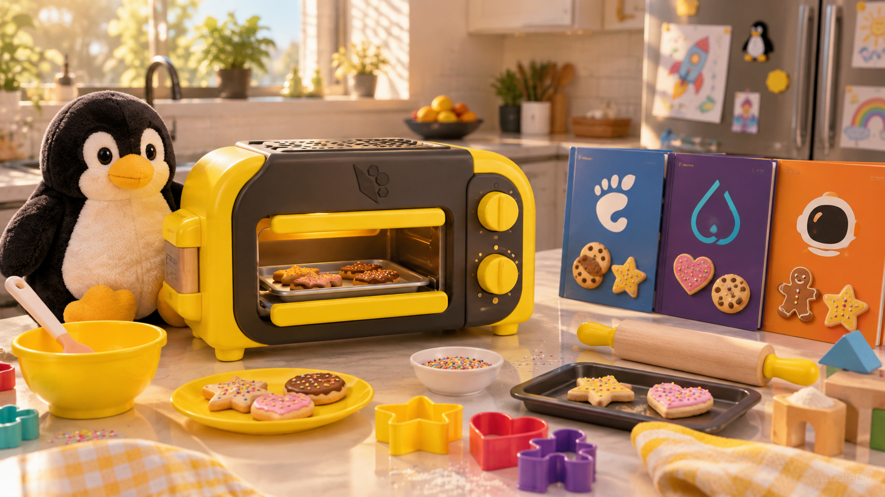

# my-anatase

Personal Anatase image for a Lenovo Legion Go: stock `i.anatase.org/anatase:stable` plus the packages in [`Containerfile`](./Containerfile) (currently just `btop`). Made from [anatase-org/template](https://github.com/anatase-org/template) with **Use this template**.

Published at `ghcr.io/realkaishady/my-anatase:stable` (also `:latest`, same image).

## How it stays up to date

[`build.yml`](./.github/workflows/build.yml) runs:

- **daily** at 19:17 UTC (06:17 Sydney in summer),
- on every push to `main` that changes the image (not README, `res/` or `examples/`),
- by hand: **Actions > Build Custom Image > Run workflow** (tick *force* to rebuild anyway).

Each run checks the upstream `stable` image and only rebuilds if its digest or this repo's commit changed. A host switched to this image then gets updates the normal way: Anatase checks weekly and applies them at shutdown.

GitHub turns scheduled runs off after 60 days with no activity in the repo (it emails first). If that happens, updates stop. Re-enable the workflow in the Actions tab or push any commit.

## What each build checks

1. **Base signature.** [`ci/verify-signature.sh`](./ci/verify-signature.sh) checks the upstream image's sigstore signature against Anatase's root CA ([`ci/anatase-cosign-root.pem`](./ci/anatase-cosign-root.pem), copied from `anatase-org/anatase`), the same rule Anatase hosts apply in `/etc/containers/policy.json`. The build then uses that exact digest. If Anatase ever replaces its CA, the build fails here until the new certificate is copied in.
2. **`bootc container lint`** runs as the last build step.
3. **Signature of the result**, once signing is set up (below).

## Signing

Until this is done, images are published **unsigned** (the workflow shows a warning). A host on an unsigned image accepts any update published under this name.

Once it's done, every image is signed, and the image itself tells the host to refuse unsigned updates of `ghcr.io/realkaishady/my-anatase` ([`signing/install-policy.sh`](./signing/install-policy.sh) adds a rule to `/etc/containers/policy.json`). The workflow refuses to run with only half of it in place.

1. On the Legion Go, Host (❯), make the key pair somewhere private (not in `Projects`). It asks for a passphrase twice:
   ```zsh
   mkdir -p /var/home/geigal/.config/my-anatase-signing && cd /var/home/geigal/.config/my-anatase-signing && skopeo generate-sigstore-key --output-prefix my-anatase
   ```
   Check: `ls -l /var/home/geigal/.config/my-anatase-signing` lists `my-anatase.private` and `my-anatase.pub`.
   Keep a copy of the private key and passphrase in your password manager. Losing it means making a new pair (and committing the new `.pub`).
2. In this repo on GitHub: **Settings > Secrets and variables > Actions > New repository secret**, twice:
   - `SIGNING_KEY`: the whole contents of `my-anatase.private`
   - `SIGNING_PASSWORD`: the passphrase
3. Commit `my-anatase.pub` as [`signing/my-anatase.pub`](./signing/). That push starts a signed build.

If the host's `/etc/containers/policy.json` was ever edited by hand, the host keeps its own copy and the new rule won't apply. Check with `sudo ostree admin config-diff | grep policy` (no output means unmodified).

## Using it on the Legion Go (Host ❯)

Before switching, look at what's booted now:
```zsh
sudo bootc status
```
Switch (the change applies at the next reboot; the current OS stays as the rollback slot, which covers `/usr` only, never `/var` or your files):
```zsh
sudo bootc switch ghcr.io/realkaishady/my-anatase:stable
```
After rebooting, check: `sudo bootc status` shows the ghcr image as booted, and `command -v btop` prints a path.

Go back to stock (Anatase's own signature rule still applies to this pull):
```zsh
sudo bootc switch i.anatase.org/anatase:stable
```
Or hold Shift at boot (or cut power during boot three times) to boot the previous OS.

**Handheld Daemon:** its update button works as usual (`bootc update`). Its channel menu switches to `<this repo>:rolling` or `:testing`, which this repo doesn't publish, so don't change channel while on this image. Switch back to stock first.

**`./update.sh`** (from the template) builds on the Legion Go itself and points the OS at local storage (`containers-storage:localhost/my-anatase:latest`). After that the weekly updater has nothing new to find until you run `./update.sh` again, and the GitHub image is no longer followed. Use it only for quick local experiments, from a **host** terminal, never in a Space. `sudo bootc switch ghcr.io/realkaishady/my-anatase:stable` puts you back on the published image.

---

## Upstream template notes

> [!NOTE]
> **Remember:** use `FROM i.anatase.org/base:stable` when you want to use a different Desktop Environment. To extend Anatase, use `FROM i.anatase.org/anatase:stable`

In the [`./examples`](./examples/) folder, you will find Containerfiles for inspiration, such as ones for Gnome and Cosmic.

The base image does not include a "Return to Gamemode" shortcut or autologin
settings in Handheld Daemon as they are KDE specific. You can configure your Desktop Environment to autologin to "Gamemode" instead.

Gnome supports selecting a session only if you have a password set (gear on the bottom right), otherwise it automatically logs in and blocks you from accessing the button. This is a Gnome issue.

Anatase uses kwallet for secret management. When you switch desktop environments you will lose your secrets, such as various logins in browsers and your IDE credentials (VS Code uses it for your Github login). The examples use the new secret manager oo7, but it is not ready for KDE at this time. This means you can switch through them without losing your secrets.

Lightdm (the Greeter used by Cinnamon and XFCE) does not respect the panel rotation reported by the kernel, so the Steam Deck has the login screen rotated 90 degrees (other portrait panels as well). They also do not associate the touchscreen correctly, so rotating the screen breaks the touchscreen. It does not re-initialize properly when exiting gamemode so you will get a black screen (PRs welcome if you fix it). Without a virtual keyboard, you cannot log in on handhelds.

Cosmic's first boot dialog does not scale properly on handhelds, so you will not be able to complete it without an external display.

**You can rebase between desktop environments arbitrarily, without reinstalling, and face minimal issues (other than losing your secrets).**
